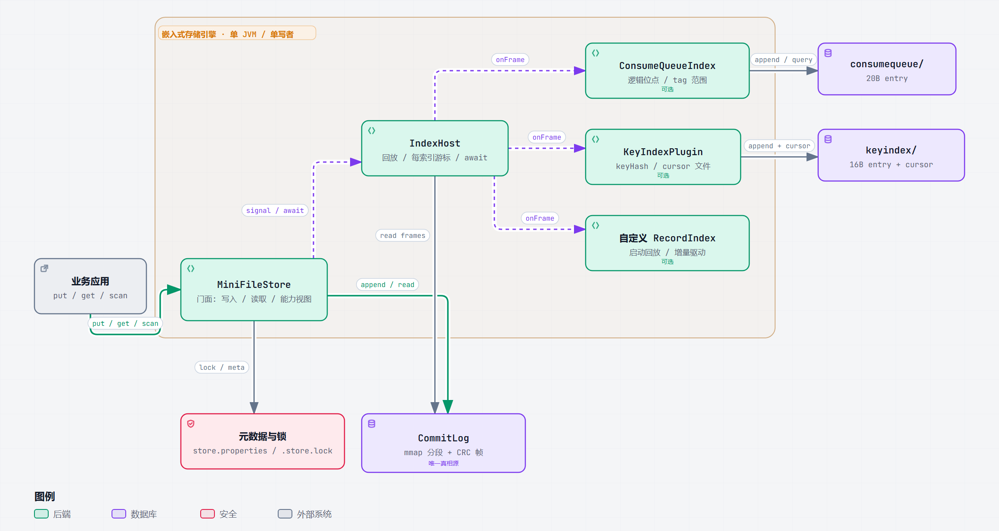

# mini-file-storage

mini-file-storage 是一个零第三方依赖的嵌入式顺序记录存储引擎。它把业务对象编码成自校验帧,顺序写入 mmap 分段文件(CommitLog),并在其上提供可选的逻辑位点索引、Key 索引和自定义索引。

它适合作为消息日志、事件溯源、审计流水、简单 KV 的持久化底座:写入路径只碰 CommitLog,索引是可重建的派生视图;索引可以按需启用,也可以由使用方实现自己的索引。

它不是完整的 MQ 或 Redis:没有消费组、事务、HA、TTL、在线 compaction 等生产能力。它更像一个可嵌入的存储内核,把 CommitLog、索引插件、恢复和刷盘拆成可以单独理解的模块。

## 核心能力

| 能力 | 作用 |
|---|---|
| 顺序追加 + 自动滚动 | CommitLog 按帧写入,单文件写满自动滚动,文件名即起始物理 offset |
| 多种读取方式 | 按物理 offset、逻辑位点、业务 key、tagCode 范围读取 |
| 可选索引 | 不装索引就是纯 WAL;按需启用 ConsumeQueue / KeyIndex / 自定义插件 |
| 自定义索引 SPI | 实现 `RecordIndex`,复用统一回放、每索引游标和生命周期 |
| 崩溃恢复 | 帧自校验、全局前缀恢复、坏尾部截断、残片隔离 |
| 只读扫描 | 固定快照遍历 CommitLog,支撑启动加载、索引重建和离线重写 |
| 持久化 | `syncFlush` 默认开启;数据 → 索引 → checkpoint 有序刷盘 |
| 索引文件工具 | 定长 entry 文件、通用恢复钩子、原子游标,供自定义索引复用 |

## 核心概念

- **CommitLog**:唯一真相源。所有记录顺序写入,只追加,不原地修改。
- **帧**:`magic + bodyLen + storeTimestamp + tagCode + keyHash + CRC32 + body`。恢复和读取都以帧为单位校验。
- **派生索引**:ConsumeQueue、KeyIndex、自定义索引都从 CommitLog 回放而来,可以删除后重建。
- **IndexHost**:索引宿主。按每个索引自己的游标回放 CommitLog,并驱动索引插件的 `onFrame`。
- **索引游标**:每个索引独立记录"已覆盖到的日志位点",互不依赖。CQ 用自时钟,KeyIndex 用游标文件,自定义索引自行决定。
- **恢复**:先恢复 CommitLog 的合法前缀,再让每个索引从自己的游标追平;索引永远可以落后,但不会越过真相。

## 工作方式



- **写**:`put` 只写 CommitLog;启用索引时,`IndexHost` 在后台按帧回调插件。
- **读**:`get(offset)` 直接读 CommitLog;逻辑位点、key、tag 查询转发给已启用的索引。
- **启动**:抢锁 → 校验元数据 → CommitLog 全局前缀恢复 → 各索引 `replayFrom` → 回放追平 → 启动索引线程(没有索引则不启动)。

SYNC 模式下,`put` 等待所有启用索引覆盖本帧后返回;ASYNC 模式下立即返回,读侧用 `awaitIndexed` 显式升级一致性。

## 快速开始

运行时要求 Java 8+;构建使用 JDK 17(产物为 Java 8 字节码)和 Maven。

Maven Central:[io.github.ispengya:file-storage:0.1.0](https://repo1.maven.org/maven2/io/github/ispengya/file-storage/0.1.0/)

```xml
<dependency>
  <groupId>io.github.ispengya</groupId>
  <artifactId>file-storage</artifactId>
  <version>0.1.0</version>
</dependency>
```

直接使用源码/IDE 时:

```bash
mvn test
mvn -DskipTests package
```

最小示例:

```java
StoreConfig config = StoreConfig.builder("./data/demo").build();

try (FileStore<LogRecord> store = new MiniFileStore<>(config, new LogRecordCodec())) {
    long now = System.currentTimeMillis();

    long offset = store.put(new LogRecord(now, "INFO", "hello"));
    LogRecord byOffset = store.get(offset);
    LogRecord byLogical = store.getByLogicalIndex(0);

    store.put(new LogRecord(now, "INFO", "order-1-body"), "order-1");
    List<LogRecord> byKey = store.getByKey("order-1");
    List<LogRecord> recent = store.queryByTagRange(now - 60_000, now);

    store.flush();
}
```

- `new MiniFileStore<>(config, codec)` 保持默认行为:启用 CQ + KeyIndex。
- `put(value)` 的默认 tagCode 是当前时间,可以直接当时间范围查询使用。
- 对象与字节的互转由 `Codec<T>` 负责;内置 `LogRecordCodec` 只是示例。
- `syncFlush` 默认 true,`put` 返回前数据文件已 force。

## 按需启用索引

builder 默认**不启用任何索引**,也就是纯 WAL:

```java
// 纯 WAL:不建索引目录、不启动索引线程
MiniFileStore<LogRecord> wal = MiniFileStore.builder(config, codec).build();

// 任选其一:
MiniFileStore<LogRecord> cqOnly = MiniFileStore.builder(config, codec)
        .withConsumeQueue().build();
MiniFileStore<LogRecord> keyOnly = MiniFileStore.builder(config, codec)
        .withKeyIndex().build();
MiniFileStore<LogRecord> both = MiniFileStore.builder(config, codec)
        .withDefaultIndexes().build();

// 自定义索引
MiniFileStore<LogRecord> custom = MiniFileStore.builder(config, codec)
        .withIndex(new MemoryKvIndex(codec))
        .build();
```

查询能力按启用情况返回:

```java
cqOnly.logical().orElseThrow(IllegalStateException::new).getByLogicalIndex(0);
keyOnly.keys().orElseThrow(IllegalStateException::new).getByKey("order-1");
custom.index(KvView.class).orElseThrow(IllegalStateException::new).get("order-1");
```

| 能力 | 依赖 |
|---|---|
| `put` / `get(offset)` / `scan` / `forEach` | 仅 CommitLog |
| `getByLogicalIndex` / `queryByTagRange` | ConsumeQueue |
| `getByKey` | KeyIndex |
| 自定义查询视图 | 对应自定义插件 |

未启用对应索引时,调用 `getByLogicalIndex` / `getByKey` / `queryByTagRange` 会抛 `IllegalStateException`。

两个实用性质:

- **后加索引不需要迁移数据**。新索引 `replayFrom()` 返回 0,内核从 CommitLog 全量回放;已有索引按自己的游标跳过重叠区。纯 WAL 期间写入的 tagCode/keyHash 仍在帧头里,后开 CQ/KeyIndex 可以补建历史索引。
- **禁用一段时间再启用**时,内置索引会从各自游标续传,补齐禁用期间写入的帧。

## 自定义索引

当内置 CQ/KeyIndex 不能满足业务查询时,实现 `RecordIndex`。内置索引也按这套 SPI 驱动,自定义索引与它们共享同一套回放、每索引游标和 flush/close 生命周期。

```java
public interface RecordIndex extends AutoCloseable {
    String name();
    long replayFrom(long logMaxOffset);
    void onFrame(long offset, RecordFrame.Frame frame, byte[] body);
    long progress();
    void flush();
    default void close() {}
}
```

契约:

- `onFrame` 必须幂等:崩溃可能从旧游标重放同一批帧。
- `replayFrom` 里应校验自身状态;全局截断后丢弃 `offset >= logMaxOffset` 的陈旧状态。
- `flush` 先刷索引数据,再原子写游标。
- `onFrame` 运行在后台索引线程,查询视图需自行保证并发安全。
- 不要在 `onFrame` 里回调 `MiniFileStore` 的读写方法:SYNC put 持有门面锁等待索引追平,会形成死锁。

内存索引示例:

```java
final class MemoryKvIndex implements RecordIndex {
    private final Map<String, Entry> map = new ConcurrentHashMap<>();
    private final Codec<Entry> codec;
    private volatile long cursor;

    public String name() { return "memory-kv"; }
    public long replayFrom(long max) { return 0; }       // 每次启动全量重建
    public void onFrame(long off, RecordFrame.Frame f, byte[] body) {
        Entry e = codec.decode(body);
        if (e.deleted()) map.remove(e.key()); else map.put(e.key(), e);
        cursor = off + f.getTotalLen();
    }
    public long progress() { return cursor; }
    public void flush() { /* 日志即真相源,无需落盘 */ }
}
```

如果索引需要自己的磁盘文件,可以复用定长 entry 工具,而不是重写文件滚动与恢复:

```java
IndexEntryCodec<MyEntry> codec = ...;   // unitSize / decode / encode / isValid
FixedUnitIndexFile<MyEntry> file =
        FixedUnitIndexFile.open("./data/my-index", 1024 * 1024, codec);

file.append(entry);
MyEntry e = file.get(0);
file.flush();
```

- `FixedUnitIndexFile` 复用 `SimpleMappedFileQueue` 的分段、滚动、恢复和物理截断。
- `IndexCursorFile` 提供原子游标;先 flush 数据,再保存游标。
- `SimpleMappedFileQueue.recoverWith(scanner)` 是通用恢复钩子,自定义格式只需定义"每个文件的有效前缀"。
- 查询语义仍由你实现:工具只提供按逻辑序号 `get(i)`,不提供 key/topic 倒排。

## 只读扫描与离线重写

`scan()` / `scanFrom()` 返回 CommitLog 的稳定快照,适合启动加载、索引重建和离线 compaction:

```java
try (RecordScanner scanner = store.scan()) {
    while (scanner.next()) {
        long offset = scanner.offset();
        LogRecord r = codec.decode(scanner.body());
        // 加载内存 Map / 重建自定义索引 / compaction
    }
}
```

- 扫描范围在创建时固定,不会追逐之后的新写入;需要"快照 + 尾部追赶"时记录 `scanner.endOffset()`,再用 `store.scanFrom(endOffset)` 续扫。
- `forEach(visitor)` 是解码版;visitor 返回 false 可提前停止。
- 扫描跨文件时会跳过封存文件尾部的浪费区。

**离线 rewrite / Redis AOF rewrite 类场景**:

1. 停止写入并关闭旧 store,或接受"快照 + 尾部追赶";
2. `scan()` 遍历旧日志,业务层做 compaction(每个 key 只保留最新值、丢弃 tombstone);
3. 写入新的 store / 新 generation 目录,flush/close;
4. 原子切换目录或指针,重新打开;
5. 新日志从 0 开始,CQ/KeyIndex/自定义索引按游标从 0 重建。

> 当前没有内置在线 rewrite/generation 热切换,也没有删头/保留策略。物理 offset 在重写后会改变,所有存物理 offset 的索引都必须重建;消费位点等权威状态必须单独保存。

## 持久化与恢复

- **刷盘顺序**:数据 → 各索引 → checkpoint。任何一步之间崩溃,checkpoint 只会滞后不会超前。
- **刷盘策略**:`syncFlush` 默认 true,每次 append 后 force 当前数据文件;吞吐优先可设 `syncFlush(false)`,由 `flush()` / `close()` 控制。
- **CommitLog 恢复**:首文件必须从 offset 0 开始、文件起始偏移连续;非末文件的残尾必须全零。损坏或缺号会在断点做全局截断,后续文件登记进 `.quarantined` 并抹掉首帧 magic;首文件缺失直接拒绝启动。
- **索引恢复**:每个索引从自己的游标续传。CQ 用最后一条 entry 的 `offset + size` 自时钟;KeyIndex 用 `keyindex/cursor` 文件;自定义索引自行实现。
- **索引可重建**:删除 CQ/KeyIndex 目录后重开,会从 CommitLog 回放重建;后加索引从 0 回放,已有索引不重复。
- **物理截断**:恢复和截断会清零被丢弃区域,重启不会复活旧 entry。
- **单写者**:同一 `baseDir` 只能有一个进程/实例打开(`.store.lock`)。
- **checkpoint**:保存 log/CQ/key 水位,用于诊断和兼容;续传以各索引自身游标为准。

## 磁盘格式

| 路径 | 内容 |
|---|---|
| `baseDir/store.properties` | 格式版本、commitLogFileSize、maxBodySize、各索引尺寸;打开时校验本次启用的索引 |
| `baseDir/data/%020d` | CommitLog 分段文件,文件名是起始物理 offset |
| `baseDir/data/.quarantined` | 全局前缀截断后不再参与恢复的文件起始 offset 清单 |
| `baseDir/consumequeue/%020d` | ConsumeQueue 分段文件 |
| `baseDir/keyindex/%020d` | KeyIndex 分段文件 |
| `baseDir/keyindex/cursor` | KeyIndex 已覆盖到的日志物理位点 |
| `baseDir/checkpoint.properties` | 双槽 checkpoint(seq + 4 水位 + CRC) |
| `baseDir/.store.lock` | 进程独占锁文件 |

```text
CommitLog 帧: [magic 4][bodyLen 4][storeTs 8][tagCode 8][keyHash 8][CRC 4][body]
CQ entry:     [physicalOffset 8][size 4][tagCode 8]
KeyIndex:     [keyHash 8][physicalOffset 8]
```

`tagCode` / `keyHash` 是帧头的通用元数据:CQ 用前者做范围查询,KeyIndex 用后者做 key 查询,自定义插件也可以直接使用,不需要解码 body。key 只存 32 位 hash,查询结果是候选集,业务需要二次校验。

## 限制

- 没有在线 rewrite、generation 热切换、删头/保留策略、TTL 或磁盘水位回收;只有离线 rewrite 的扫描入口。
- 没有消费位点 / 消费组 / ack / 重试 / 事务 / 批量写 / HA;这些属于上层协议或独立 `StateStore`。
- ConsumeQueue 与 KeyIndex 没有 entry 级 CRC;CQ 恢复只做尾部交叉校验,KeyIndex 仍是线性扫描,没有 hash 槽。
- `queryByTagRange` 假设 tagCode 单调(默认写时间戳)。
- 门面方法基本是 `synchronized`,同步刷盘默认开启;高并发/高吞吐场景需要进一步分层或组提交。
- 不是生产级 MQ/Redis,定位是可嵌入的存储内核和学习/实验底座。

## 项目结构

```text
.
├── pom.xml
├── README.md
├── LICENSE
├── RELEASING.md
├── assets/readme/                    # README 图片
└── src/
    ├── main/java/com/ispengya/file/
    │   ├── api/                      # FileStore / MiniFileStore / 扫描与能力接口
    │   ├── core/                     # mmap 日志、帧、分段文件队列
    │   ├── index/                    # RecordIndex SPI、CQ/KeyIndex 插件、索引文件工具
    │   ├── store/                    # RecordStore、IndexHost、checkpoint、元数据
    │   ├── codec/                    # Codec 与 LogRecordCodec
    │   └── model/                    # LogRecord
    └── test/java/com/ispengya/file/  # 测试
```

## 运行测试

```bash
mvn test
```

测试覆盖写入与重启恢复、可选/自定义索引、扫描、截断和索引文件工具等路径。
